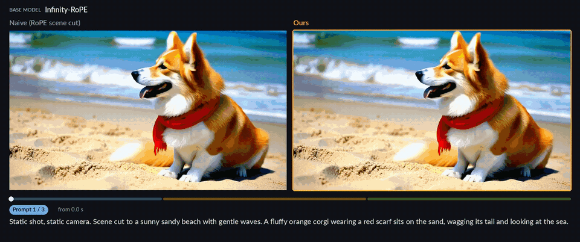

# Residual Guidance for Real-Time Interactive Video Generation

<p align="center">
  NaHyeon Park<sup>1</sup>, Kyeong-Hwan Moon<sup>2</sup>, Youjin Jeon<sup>1</sup>, Hyunjung Shim<sup>1</sup><br>
  <sup>1</sup>KAIST &nbsp; <sup>2</sup>POSTECH
</p>

<p align="center">
  <a href="https://residual-guidance.github.io"></a>
  <a href="#"></a>
</p>

**TL;DR** Autoregressive video models often ignore a new prompt given mid-generation, because the cached past keeps pulling
the video back. Residual guidance is a training-free fix that makes the video follow the new prompt while staying continuous.



**How it works.** When the prompt changes during chunk-wise generation, the KV cache of the old prompt keeps the new chunks in the
old scene ("context inertia"). Residual guidance re-noises the previous chunk, predicts it once under the new prompt with the cached
context hidden, and adds the difference (the residual) to the next chunk's early denoising steps. It plugs into Self Forcing,
Causal Forcing, LongLive and Infinity-RoPE as they are, without changing their weights.

```
z   = add_noise(s_{j-1}, eps, t*)                         # s_{j-1}: clean output of the previous chunk
r_j = x0(z | new prompt, context hidden) - s_{j-1}
x0(step 1) += 1.0 r_j,   x0(step 2) += 0.5 r_j            # for every chunk from a switch to the next one
```

Defaults: `t* = 850` (adjustable with `--t`, see [Choosing t*](#choosing-t)), step weights `(1.0, 0.5)`, one `eps` per switch. Every chunk of a new prompt's interval is guided,
with one extra forward per guided chunk.

## Files

| file | content |
|---|---|
| `residual_guidance.py` | the method: attention patch that hides the cached context, and a chunk-wise rollout with prompt switches and residual guidance |
| `generate.py` | loads an upstream model and generates videos for a prompt file |
| `pyproject.toml`, `uv.lock` | the environment (`uv sync`) |
| `prompts/ab_pairs.json` | 200 A/B attribute-switch pairs, 5 s (7 chunks), switch at chunk 3 |
| `prompts/storyeval_10s.json` | 100 StoryEval 3-event stories, 10 s (14 chunks), switches at chunks 4 and 9 |
| `prompts/interactive_60s.json` | 100 InteractiveBench scripts, 60 s (80 chunks), 6 prompts |
| `prompts/scene_cut_10s.json` | 20 three-scene stories for Infinity-RoPE's scene cut, 10 s (14 chunks), switches at chunks 4 and 9 |

## Installation

We recommend [uv](https://docs.astral.sh/uv/). `pyproject.toml` pins one environment (Python 3.10, PyTorch 2.5.1 + CUDA 12.1,
prebuilt flash-attn) that runs all four backbones:

```bash
curl -LsSf https://astral.sh/uv/install.sh | sh     # if uv is not installed
git clone https://github.com/nahyeonkaty/residual-guidance.git
cd residual-guidance
uv sync                                             # creates .venv
uv run python generate.py --help                    # or: source .venv/bin/activate
```

The upstream repositories are used unmodified and need no environment of their own: clone them and download their checkpoints
as in their READMEs.

* Self Forcing: https://github.com/guandeh17/Self-Forcing (`self_forcing_dmd.pt`)
* Causal Forcing: https://github.com/thu-ml/Causal-Forcing (chunk-wise DMD checkpoint, `causal_forcing.pt`)
* LongLive: https://github.com/NVlabs/LongLive (`longlive_base.pt`, `lora.pt`)
* Infinity-RoPE: https://github.com/yesiltepe-hidir/infinity-rope (`checkpoints/ema_model.pt`)

All of them need `wan_models/Wan2.1-T2V-1.3B` (T5 / VAE) in the working directory (`--workdir`, default `--repo`):

```bash
uv run huggingface-cli download Wan-AI/Wan2.1-T2V-1.3B --local-dir wan_models/Wan2.1-T2V-1.3B
```

## Usage

One script, `generate.py`, for all backbones. Pick the backbone, point it to the upstream repo and checkpoint, and choose a prompt
file and a method:

```bash
python generate.py --backbone <backbone> --repo <upstream repo> --ckpt <checkpoint> \
    --prompts <prompt file> --method rg --out <output folder>
```

Use `--method naive` for the baseline (the prompt just changes, no guidance).

### Examples

**Self Forcing** (A/B attribute switches)
```bash
python generate.py --backbone self_forcing \
    --repo /path/to/Self-Forcing --ckpt /path/to/self_forcing_dmd.pt \
    --prompts prompts/ab_pairs.json --method rg --out out/sf_rg
```

**Causal Forcing** (StoryEval stories)
```bash
python generate.py --backbone causal_forcing \
    --repo /path/to/Causal-Forcing --ckpt /path/to/causal_forcing.pt \
    --prompts prompts/storyeval_10s.json --method rg --out out/cf_rg
```

**LongLive** (InteractiveBench, 60 s), with LongLive's own KV recache at every switch
```bash
python generate.py --backbone longlive \
    --repo /path/to/LongLive --ckpt_dir /path/to/longlive_models --recache \
    --prompts prompts/interactive_60s.json --method rg --out out/ll_rg
```

**Infinity-RoPE** (scene changes), with a RoPE scene cut at every switch
```bash
python generate.py --backbone infinity_rope \
    --repo /path/to/infinity-rope --ckpt /path/to/infinity-rope/checkpoints/ema_model.pt --scene_cut --t 900 \
    --prompts prompts/scene_cut_10s.json --method rg --out out/ir_rg
```
Scene-cut prompts work best in Infinity-RoPE's style: "Static shot, static camera. Scene cut to <place>. <subject> <action>."

### Options

| option | meaning |
|---|---|
| `--backbone` | `self_forcing`, `causal_forcing`, `longlive` or `infinity_rope` |
| `--repo` | upstream repo folder (LongLive: the folder with `configs/longlive_interactive_inference.yaml`) |
| `--ckpt` | generator checkpoint (Self Forcing, Causal Forcing, Infinity-RoPE) |
| `--ckpt_dir` | LongLive only: folder with `longlive_base.pt` and `lora.pt` |
| `--workdir` | folder that holds `wan_models/` (default: `--repo`) |
| `--prompts` | prompt file (see below) |
| `--method` | `rg` (residual guidance, default) or `naive` |
| `--out` | output folder |
| `--t` | re-noising timestep t* (default 850; see [Choosing t*](#choosing-t)) |
| `--recache` | LongLive only: LongLive's KV recache at every switch (the LongLive setting of the paper) |
| `--scene_cut` | Infinity-RoPE only: RoPE scene cut at every switch, for hard scene changes |
| `--ids` | generate only these item ids |
| `--save_latents` | also save the latents (`.pt`) |

Each video is saved as `<out>/<id>.mp4` (e.g. `001.mp4`, 832x480, 16 fps), with a `.json` holding its prompts and settings.

### Choosing t*

`--t` sets how strongly the new prompt is pushed in. The larger t*, the noisier the re-noised previous chunk, so the residual can
change more of the video; the smaller t*, the more of the previous chunk is kept.

* **Around 850 (default):** recommended for most switches, e.g. changing an attribute, an action or part of the scene while the
  rest of the video stays the same.
* **900 to 950:** recommended for scene cuts (`--scene_cut`) and other switches that change the overall layout of the video.

**Note:** try a lower t* if the video changes more than the new prompt asks for, and a higher t* if the new prompt is not reached.

### Prompt files

```json
{"items": [{"id": 1, "seed": 0, "n_chunks": 7, "switch_chunks": [3],
            "prompts": ["A green leaf on a tree branch, swaying gently in the breeze, ...",
                        "A bright red leaf on a tree branch, swaying gently in the breeze, ..."]}]}
```

One chunk is 12 video frames (0.75 s). The first prompt is used from chunk 0, and prompt `q` from chunk `switch_chunks[q - 1]` on
(here: the green leaf for chunks 0-2, the red leaf for chunks 3-6).

## Using it in another pipeline

```python
import wan.modules.causal_model as cm
import residual_guidance as RG
RG.patch_attention(cm)                          # once, before generating
video_latents = RG.rollout(pipe, noise, conds, chunk_prompt, rg=RG.RGConfig(), init_caches=..., on_switch=...)
```

`rollout` follows the upstream `CausalInferencePipeline.inference` loop (4 denoising steps per chunk, then a clean cache pass) and
works with any repo built on `wan/modules/causal_model.py`. Within a chunk RoPE is relative, so the context-free restore pass is
run at the current chunk's position.

## License

This code is released under the [MIT License](LICENSE). The upstream models (Self Forcing, Causal Forcing, LongLive, Infinity-RoPE,
Wan2.1) and their checkpoints keep their own licenses.

## Citation

```bibtex
@article{park2026residual,
  title   = {Residual Guidance for Real-Time Interactive Video Generation},
  author  = {Park, NaHyeon and Moon, Kyeong-Hwan and Jeon, Youjin and Shim, Hyunjung},
  journal = {arXiv preprint},
  year    = {2026}
}
```
